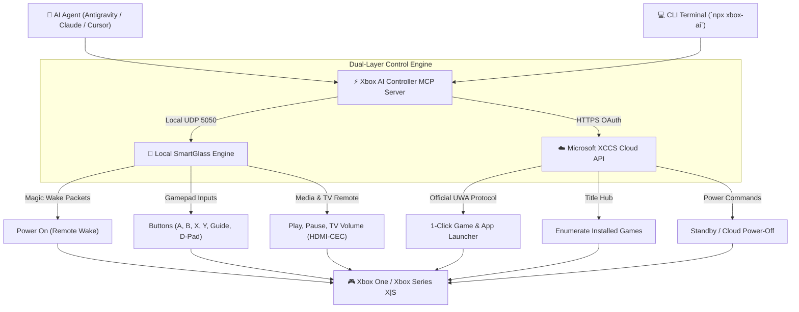

# 🎮 Xbox AI Controller

[](LICENSE)
[](https://nodejs.org/)
[](https://modelcontextprotocol.io/)
[](https://xbox.com/)

> **Control your Xbox One & Xbox Series console directly from AI Agents (Antigravity, Claude, Cursor) or CLI using natural language.**

Launch games (FC 25, Minecraft, Halo, etc.), send controller button presses, manage media playback, adjust TV volume via HDMI-CEC, and power on/off over Wi-Fi and official Microsoft Cloud APIs.

---

## ⚡ Architecture: The Dual-Layer Engine

`xbox-ai-controller` combines two complementary communication protocols to give your AI agent complete command over your console:



1. **Local SmartGlass Engine (UDP Port 5050)**:
   * Direct, zero-latency local network communication.
   * Remote Wake-up magic packets (`0xdd02`).
   * Controller button presses (`A`, `B`, `X`, `Y`, `D-Pad`, `Nexus / Guide Menu`, `Menu`, `View`).
   * Media playback control (`Play`, `Pause`, `Stop`, `Next`, `Previous`, `Rewind`, `Fast-Forward`).
   * TV / soundbar volume control via console HDMI-CEC (`Volume Up`, `Volume Down`, `Mute`).
2. **Microsoft Console Command Service (XCCS Cloud)**:
   * Official Microsoft UWA protocol (`xccs.xboxlive.com`).
   * **1-Click Game Launching**: Bypasses manual on-screen navigation to boot any game or app directly by name (e.g., *"Open FC 25"*, *"Launch Minecraft"*, *"Open YouTube"*).
   * **Safe 2FA Authentication**: Uses Microsoft's official device-code flow (`microsoft.com/link`) — no passwords needed.

---

## ✨ Features

- 🎯 **1-Click Game Launcher**: Launch installed titles (*EA Sports FC 25*, *Minecraft*, *Cricket 24*, *Halo Infinite*, *Asphalt Legends*, *War Thunder*, *Netflix*, *Spotify*, etc.) by name.
- ⚡ **Zero-Lag Gamepad Navigation**: Navigate menus and dashboards using virtual controller inputs.
- 📺 **Media & TV Volume Remote**: Play/pause streaming apps and adjust TV volume through HDMI-CEC.
- 🔌 **Power Management**: Wake the console from Sleep mode or put it into standby remotely.
- 🔐 **2FA-Friendly Device-Code Auth**: Authenticate using official `microsoft.com/link` codes without exposing your password in chat.
- 🤖 **Universal MCP Support**: Plugs into Google Deepmind's **Antigravity CLI (`agy`)**, **Claude Desktop**, **Cursor**, **Windsurf**, or custom LLM frameworks.
- 💻 **Standalone CLI Included**: Every feature can be run directly from terminal (`npx xbox-ai`) without an AI agent.

---

## 🚀 Quickstart

### 1. Installation

Clone and install dependencies:

```bash
git clone https://github.com/humairanwer/xbox-ai-controller.git
cd xbox-ai-controller
npm install
```

### 2. Configure Your Xbox Console (One-Time)

On your Xbox One or Xbox Series console:
1. **Enable Sleep Mode**:
   * Go to **Settings > General > Power options** and select **Sleep** (Instant-On).
2. **Enable Remote Features**:
   * Go to **Settings > Devices & connections > Remote features** and check **Enable remote features**.
   * Under Xbox app preferences, select **Allow connections from any device**.

### 3. Discover Your Console

Run the discovery tool on the same Wi-Fi/LAN:

```bash
node bin/cli.js discover
```

It will detect your Xbox's IP address, name, and Live Device ID, and save them automatically to `~/.xbox-mcp/config.json`.

### 4. Authenticate for 1-Click Game Launching

To allow your AI agent to launch games directly without manual on-screen navigation:

```bash
node bin/cli.js login
```

1. Open the URL displayed on your screen: 👉 **[https://www.microsoft.com/link](https://www.microsoft.com/link)**
2. Enter the short code displayed in the terminal.
3. Approve with your Xbox account. Tokens are securely stored locally on your machine.

---

## 🤖 AI Agent Integration (MCP Setup)

### Antigravity CLI (`agy`)
Add `xbox` to your global `mcp_config.json` (`~/.gemini/config/mcp_config.json`):

```json
{
  "mcpServers": {
    "xbox": {
      "command": "node",
      "args": [
        "E:\\Development\\xbox-ai-controller\\src\\server.js"
      ]
    }
  }
}
```

### Claude Desktop
Add to your Claude Desktop config (`claude_desktop_config.json`):

```json
{
  "mcpServers": {
    "xbox": {
      "command": "node",
      "args": [
        "E:\\Development\\xbox-ai-controller\\src\\server.js"
      ]
    }
  }
}
```

---

## 💬 Natural Language Prompts

Once configured, simply talk to your AI agent naturally:

- *"Turn on my Xbox"*
- *"Launch EA Sports FC 25"*
- *"Open Minecraft"*
- *"Open YouTube"*
- *"Go back to the Home screen"*
- *"Press the Xbox Guide button"*
- *"Press Down and select A"*
- *"Pause the video"*
- *"Turn the TV volume up"*
- *"Record that game clip"*
- *"Put my Xbox to sleep"*

---

## 🛠️ CLI Usage Guide

You can also use the controller directly from your terminal:

```bash
# Scan local network for consoles
node bin/cli.js discover

# Power on / wake
node bin/cli.js wake

# Launch games & apps
node bin/cli.js launch "FC 25"
node bin/cli.js launch "Minecraft"
node bin/cli.js launch "YouTube"
node bin/cli.js launch "Home"

# List installed games on console
node bin/cli.js apps

# Controller button navigation
node bin/cli.js button nexus    # Open Guide menu
node bin/cli.js button a        # Select (A)
node bin/cli.js button b        # Back (B)
node bin/cli.js button down     # D-Pad Down

# Media & Volume
node bin/cli.js media playpause
node bin/cli.js volume up
node bin/cli.js volume down

# Power off
node bin/cli.js off
```

---

## 🎮 Available MCP Tools

| Tool | Parameters | Description |
| :--- | :--- | :--- |
| `xbox_discover` | `timeout_seconds` | Scans local subnet for active/standby Xbox consoles. |
| `xbox_power_on` | `ip`, `live_device_id` | Sends SmartGlass wake packet burst (`0xdd02`). |
| `xbox_power_off` | `ip` | Puts the console into standby/sleep mode. |
| `xbox_ping` | `ip` | Checks if console is active and listening on port 5050. |
| `xbox_launch` | `target` (required) | 1-Click game/app launch (FC 25, Minecraft, etc.) or go Home. |
| `xbox_installed_apps` | *none* | Fetches the full list of installed games from console. |
| `xbox_button` | `button` (required) | Sends button press (`a`, `b`, `x`, `y`, `nexus`, `menu`, `view`, `dpad`). |
| `xbox_media` | `command` (required) | Controls media playback (`play`, `pause`, `stop`, `next`, `prev`). |
| `xbox_volume` | `command` (required) | Adjusts TV volume via HDMI-CEC (`volume_up`, `volume_down`, `mute`). |
| `xbox_record_dvr` | `ip` | Triggers the *"Record that!"* command to save last 30s game clip. |
| `xbox_auth_device_code` | *none* | Starts 2FA-safe Microsoft Device-Code authentication flow. |
| `xbox_get_config` | *none* | Inspects current saved configuration and connection state. |
| `xbox_set_config` | `ip`, `live_device_id`, etc. | Updates settings manually. |

---

## 🔒 Security & Privacy

- **No Passwords Stored**: Authentication uses official Microsoft OAuth Device-Code flow. Passwords are never handled or logged.
- **Local Storage**: All tokens, configuration, and IP addresses remain strictly on your local PC in `~/.xbox-mcp/` and are excluded in `.gitignore`.
- **First-Party Microsoft APIs**: Cloud commands communicate exclusively with `https://xccs.xboxlive.com` using standard TLS encryption.

---

## 📄 License

This project is licensed under the [MIT License](LICENSE).
